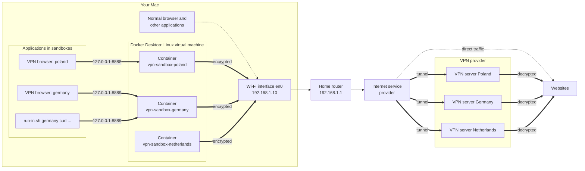
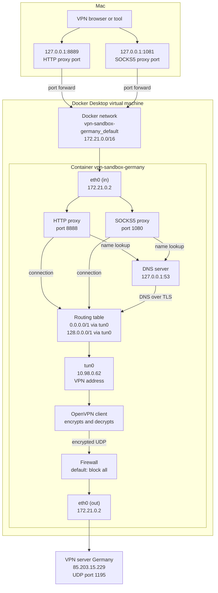
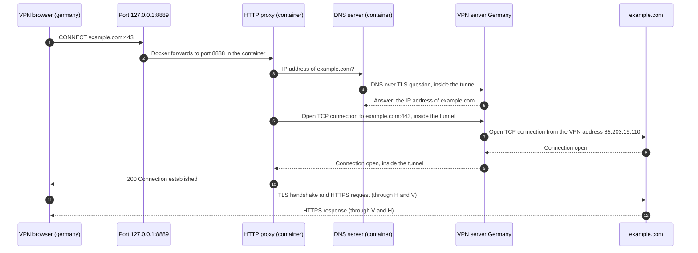
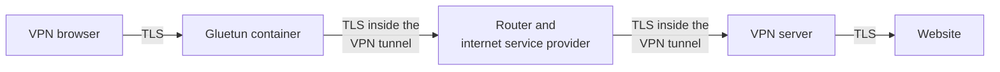
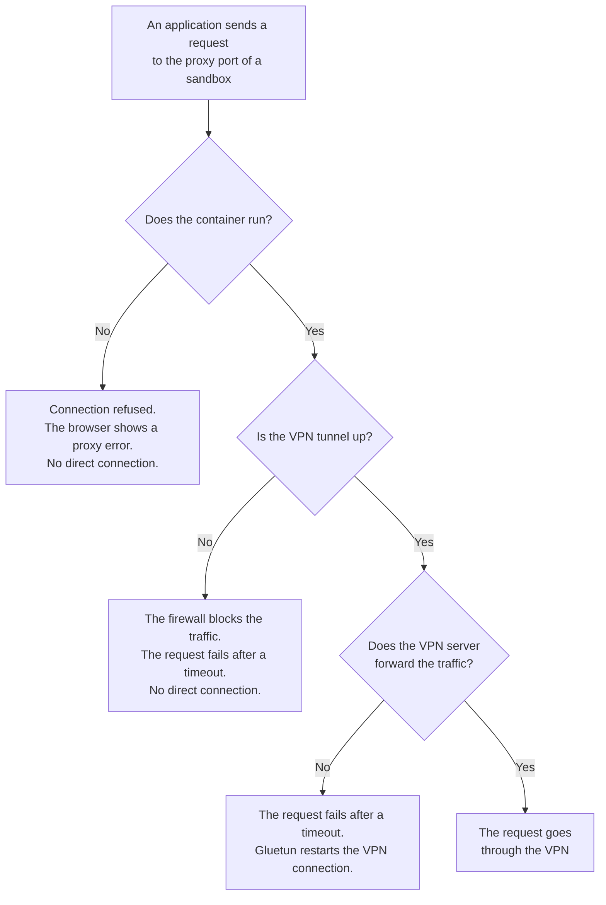
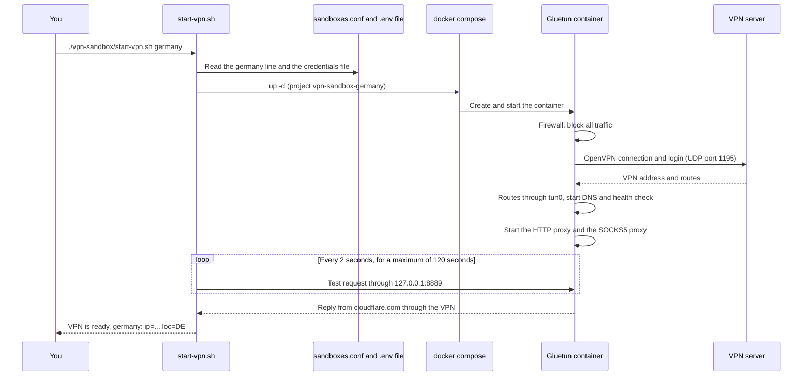

# network-sandbox

## vpn-sandbox: applications through a VPN, one country each

The `vpn-sandbox` setup sends the traffic of selected applications through a VPN service. Each **sandbox** connects to one country of one VPN provider. You can run many sandboxes at the same time. Your normal applications do not use the VPN.

Applications that can use a sandbox:

- **Browsers:** Chrome, Brave, Edge, Chromium, Vivaldi and Firefox. Each browser instance is separate from your normal browser.
- **Command-line tools:** `curl`, `git`, `pip`, `npm`, `yt-dlp` and all other tools that read the standard proxy variables.
- **Other applications** that have a proxy setting (HTTP or SOCKS5).

The setup uses [Gluetun](https://github.com/qdm12/gluetun), so the setup works with all VPN providers that Gluetun supports. The examples in this document use ExpressVPN.

### Terms

In this document, these names have one meaning each:

- **Sandbox:** one VPN connection to one country, with its own proxies. Each sandbox has a name, for example `germany`.
- **Proxy:** a server that receives network traffic from an application and sends the traffic on. Each sandbox has two proxies:
  - an **HTTP proxy**, for browsers and most tools;
  - a **SOCKS5 proxy**, a more general proxy type, for applications that need SOCKS5.
- **Port:** a number that identifies one service on a computer. Each proxy of each sandbox has its own port.
- **VPN browser:** a separate browser instance that uses a sandbox.
- **Normal browser:** your usual browser, which does not use the VPN.
- **Terminal:** the macOS application where you type commands.

### How the setup works

For each sandbox:

1. A Docker container runs Gluetun. Gluetun connects to the VPN provider of the sandbox with the OpenVPN protocol or the WireGuard protocol.
2. Gluetun runs an HTTP proxy and a SOCKS5 proxy on two ports of this Mac. Only this Mac can use the proxies.
3. You start an application through a script. The script tells the application to send its traffic to the proxy of the sandbox.

| Sandbox | Provider | Country | HTTP port | SOCKS5 port | Container |
|---|---|---|---|---|---|
| `poland` | `expressvpn` | Poland | `8888` | `1080` | `vpn-sandbox-poland` |
| `germany` | `expressvpn` | Germany | `8889` | `1081` | `vpn-sandbox-germany` |
| `netherlands` | `expressvpn` | Netherlands | `8890` | `1082` | `vpn-sandbox-netherlands` |

The file `vpn-sandbox/sandboxes.conf` contains these settings. For diagrams of the traffic paths, the routing, the firewall and the encryption, see [Network design](#network-design).

| Application | Traffic path |
|---|---|
| Normal applications | Directly to the internet |
| Application in a sandbox | Proxy of the sandbox → Gluetun container → VPN server → internet |

The split tunneling feature of a VPN app cannot do this. Split tunneling selects traffic by application, so it cannot put two instances of the same browser in different countries.

### Requirements

- Docker Desktop.
- At least one supported browser, if you want VPN browsers.
- An account with a VPN provider that Gluetun supports, and the **manual configuration** credentials of that account. See [Credentials files](#credentials-files).

### Limits

- **Device limit.** Each running sandbox is one connected device on your VPN subscription. Phones and other computers that use the same VPN account at the same time also count. Check the device limit of your plan on the website of the VPN provider.
- **Browser fingerprint.** A browser fingerprint is a set of facts that a website reads with JavaScript, for example the graphics hardware, the screen size, the fonts and the time zone. Each sandbox has a different IP address and different cookies. But the fingerprint shows that all VPN browsers run on the same computer. A different browser in each sandbox makes the fingerprints partly different.
- **Time zone.** All VPN browsers report the time zone of your Mac, not the time zone of the VPN country.
- **Shared VPN addresses.** Many customers of the VPN provider share each VPN IP address. Websites can limit or block these addresses. See [Troubleshooting](#troubleshooting).
- **TCP only.** The proxies carry TCP traffic (web pages, downloads, most tools). They do not carry UDP traffic, which some video calls and games use.

## Network design

This section shows how the traffic moves, with diagrams. The diagrams use the Mermaid format. GitHub and many Markdown editors show Mermaid diagrams as pictures.

The examples use the `germany` sandbox. The addresses are real values from 2026-10-16. The VPN addresses and the Docker addresses change when a container starts again. The ports stay the same, because they come from `sandboxes.conf`.

### Diagram 1: The full picture

Your Mac has two types of traffic:

- **Direct traffic** (dotted lines) from normal applications. This traffic goes through the router to the website directly.
- **Sandbox traffic** (thick lines) from applications in sandboxes. This traffic goes to a local proxy port, then into a Gluetun container, and then through an encrypted tunnel to a VPN server. The VPN server sends the traffic on to the website.



Important points:

- The Gluetun containers run in a Linux virtual machine that Docker Desktop manages. The containers still use the network connection of the Mac (`en0`) to reach the internet.
- The proxy ports listen only on `127.0.0.1`, the **loopback address**. The loopback address is available only inside the Mac. Other devices on your network cannot use the proxies.
- Each sandbox has its own tunnel to its own VPN server. The sandboxes do not share a tunnel.
- If a VPN app on the Mac is connected, the encrypted traffic of the containers also goes through that VPN app. This is why you disconnect the VPN app first.

### Diagram 2: Inside one sandbox container

Each container has two network interfaces. A **network interface** is a connection point between a computer and a network.

- `eth0` connects the container to its own Docker network. Traffic from the Mac comes in on `eth0`. The encrypted VPN traffic also goes out on `eth0`.
- `tun0` is the VPN tunnel interface. Traffic that goes into `tun0` comes out decrypted at the VPN server.

In the diagram, `eth0` has two boxes (in and out) to make the direction clear. Both boxes are the same interface.



#### The routing table

A **routing table** tells the container which interface to use for each destination address.

| Destination | Interface | Why |
|---|---|---|
| `0.0.0.0/1` (addresses `0.x.x.x` to `127.x.x.x`) | `tun0` | Sends the first half of all internet addresses into the VPN tunnel. |
| `128.0.0.0/1` (addresses `128.x.x.x` to `255.x.x.x`) | `tun0` | Sends the second half of all internet addresses into the VPN tunnel. |
| `85.203.15.229` (the VPN server) | `eth0` | Sends the encrypted packets to the VPN server outside the tunnel. Without this route, the packets would go into the tunnel again. |
| `172.21.0.0/16` (the Docker network) | `eth0` | Lets the proxies reply to the Mac. |
| `default` (all other addresses) | `eth0` | Not in use for internet traffic. The two `/1` routes are more specific, so they always win. |

The two `/1` routes together cover all addresses. A more specific route always wins over the `default` route. Thus, all internet traffic goes into the tunnel, and the `default` route stays for the VPN server only.

#### The firewall (kill switch)

The container firewall blocks all traffic, except the traffic in this table. This makes a **kill switch**: if the tunnel does not work, no traffic can leave the container without encryption.

| Direction | Permitted traffic |
|---|---|
| Out | All traffic into `tun0` (the tunnel). |
| Out | UDP to the VPN server (`85.203.15.229`, port `1195`) on `eth0`. This is the encrypted tunnel itself. |
| Out | Replies to the Docker network (`172.21.0.0/16`), for example proxy replies to the Mac. |
| In | Traffic from the Docker network on `eth0`, for example requests from the Mac to the proxy ports. |
| In and out | Replies to connections that are already open, and traffic inside the container (`lo`). |
| **All other traffic** | **Blocked.** |

#### DNS

**DNS** changes a name (for example `example.com`) into an IP address. The proxies use the DNS server of the container (`127.0.0.1:53`). That DNS server sends its questions to Cloudflare with **DNS over TLS** (encrypted DNS), through the tunnel. Thus, your internet service provider does not see the names of the websites. The SOCKS5 address uses `socks5h://`. The `h` tells the application to let the proxy do the DNS lookup.

### Diagram 3: One HTTPS request, step by step

This diagram shows how a VPN browser in the `germany` sandbox opens `https://example.com`.



Explanations of the steps:

- **Step 1:** The browser asks the proxy to open a connection with the `CONNECT` command. The browser sends only the name and the port. The page content stays encrypted.
- **Steps 3 to 5:** The container does the DNS lookup. The Mac does not do a DNS lookup for this website.
- **Step 7:** The website sees the VPN address (`85.203.15.110`), not your home address. The VPN server uses one address for the tunnel (`85.203.15.229`) and another address for the internet traffic (`85.203.15.110`).
- **Steps 11 and 12:** The browser and the website use TLS (HTTPS) end to end. The proxy and the VPN server forward the encrypted data but cannot read it.

A request through the SOCKS5 proxy uses the same path. Only the first steps are different: the application uses the SOCKS5 protocol in place of `CONNECT`.

### Diagram 4: Encryption layers

Sandbox traffic has two layers of encryption between your Mac and the VPN server: TLS (HTTPS) from the browser, and the VPN tunnel. Between the VPN server and the website, only TLS stays.



What each party can see:

| Party | Can see | Cannot see |
|---|---|---|
| Your router and internet service provider | That you connect to a VPN server, how much data, and when | The websites, the DNS names and the page content |
| The VPN provider | Your home IP address and the websites that you connect to | The page content (TLS protects it) |
| The website | The VPN IP address, the browser fingerprint and the time zone of your Mac | Your home IP address |
| The Gluetun proxy (on your Mac) | The website names and ports | The page content |

**Note:** Plain HTTP pages (without the `s`) have no TLS layer. The VPN provider can read plain HTTP traffic.

### Diagram 5: What happens when something fails

The setup does not fall back to a direct connection.



- **The container does not run:** nothing listens on the proxy port. The browser shows an error, for example `ERR_PROXY_CONNECTION_FAILED`.
- **The tunnel is down:** the firewall permits only the VPN server on `eth0`. Thus, the traffic cannot leave the container.
- **The server does not forward traffic:** this happened with the ExpressVPN Romania server. The Gluetun **health check** (a regular test of the connection) finds the problem and restarts the VPN connection.

The scripts add one more safety check: `open-browser.sh` and `run-in.sh` test the proxy first. If the test fails, they do not start the application.

### Diagram 6: The start of a sandbox



The firewall starts before the VPN connection. Thus, no traffic can leave the container without encryption, also during the start.

## Migration from the old chrome-vpn setup (one time)

Do this section only if you used the old `chrome-vpn` folder. The old setup had other container names and Chrome profile folders, and no SOCKS5 proxy.

**Caution:** Close all old VPN Chrome windows before you start the migration. The script refuses to run while an old VPN Chrome is open.

1. In each old VPN Chrome, click a window and push **Cmd + Q**.
2. In Terminal, type these commands:
   ```
   cd ~/dev/network-sandbox
   ./vpn-sandbox/migrate-from-chrome-vpn.sh
   ```

The script does these steps:

1. It removes the old containers (`chrome-vpn-gluetun`, `chrome-vpn-germany`, `chrome-vpn-netherlands`).
2. It moves the old Chrome profiles to `~/.vpn-sandbox/profiles/<sandbox>-chrome`. Your bookmarks, logins and history stay.
3. It starts all sandboxes with the new names and the SOCKS5 ports, and shows the IP address of each sandbox.

You can run the script again. It skips the steps that are already done. After the migration, you can delete the script.

## Credentials files

Each VPN provider has one credentials file: `vpn-sandbox/.env.<provider>`. For example, ExpressVPN uses `vpn-sandbox/.env.expressvpn`. All sandboxes of the same provider use the same file.

A credentials file contains:

- The credentials of your VPN account. OpenVPN usually needs a username and a password. WireGuard usually needs a **private key** (a secret value that identifies your device) and an address.
- `VPN_TYPE`: `openvpn` or `wireguard`.

**Caution:** Do not commit a credentials file. The `.gitignore` file excludes all files that start with `.env`, except the templates (`*.example`).

The file `vpn-sandbox/.env.expressvpn.example` is a template for ExpressVPN. For other providers, the Gluetun wiki gives the necessary variables: <https://github.com/qdm12/gluetun-wiki/tree/main/setup/providers>.

## One-time setup (ExpressVPN)

1. Get the ExpressVPN **manual configuration** credentials for OpenVPN. These credentials are not your account email and password. On the ExpressVPN website, go to **Set up on more devices** > **Manual Configuration** > **OpenVPN**.
2. Open Terminal. Push **Cmd + Space**, type `Terminal`, and push **Return**.
3. Go to the project folder:
   ```
   cd ~/dev/network-sandbox
   ```
4. Copy the template file:
   ```
   cp vpn-sandbox/.env.expressvpn.example vpn-sandbox/.env.expressvpn
   ```
5. Open the credentials file in TextEdit:
   ```
   open -e vpn-sandbox/.env.expressvpn
   ```
6. Replace `REPLACE_WITH_USERNAME` and `REPLACE_WITH_PASSWORD` with your credentials. Save the file.

## Start a sandbox

Run all commands from the folder `~/dev/network-sandbox`. The examples use `germany`. Replace `germany` with the name of the sandbox that you want.

### Step 1: Disconnect the VPN app on the Mac

If a VPN app on the Mac (for example the ExpressVPN app) shows **Connected**, disconnect it.

If a VPN app on the Mac stays connected, all traffic of the Mac uses that VPN, and your normal applications also use that VPN.

### Step 2: Make sure that Docker Desktop runs

Look for the Docker whale icon in the macOS menu bar, at the top of the screen. If the icon is not there, open **Docker Desktop** from the Applications folder. Wait until Docker Desktop shows that the engine is running.

### Step 3: Start the sandbox

```
./vpn-sandbox/start-vpn.sh germany
```

To start all sandboxes, use `all` in place of the name:

```
./vpn-sandbox/start-vpn.sh all
```

The script starts the container and waits for the VPN connection. The wait is usually 10 to 30 seconds. When the VPN works, the script shows a line like this:

```
VPN is ready. germany: ip=85.203.15.110 loc=DE
```

If the sandbox already runs, the script says so and only checks the connection:

```
germany is already running: Up 11 minutes (healthy). Checking the connection...
VPN is ready. germany: ip=45.86.202.250 loc=DE
```

The script does not stop or restart the other sandboxes. At the end, the script lists the other sandboxes that also run:

```
Other sandboxes that also run:
  poland: Up 11 minutes (healthy)
  netherlands: Up 11 minutes (healthy)
To stop one, run: ./vpn-sandbox/stop-vpn.sh <sandbox>
```

A sandbox continues to run until you stop it, also after a restart of the Mac. Each running sandbox uses one device connection of your VPN account.

### Step 4: Check the sandboxes (optional)

```
./vpn-sandbox/check-ip.sh
```

The output shows the direct IP address and the IP address of each sandbox. The `SOCKS5` column shows if the SOCKS5 proxy works:

```
SANDBOX        PORTS        SOCKS5 PUBLIC IP (through the HTTP proxy)
direct         -            -      "ip":"203.0.113.10","city":"YourCity","country":"US",
poland         8888/1080    ok     "ip":"188.212.135.227","city":"Warsaw","country":"PL",
germany        8889/1081    ok     ip=85.203.15.110 loc=DE
netherlands    8890/1082    ok     "ip":"45.86.200.29","city":"TheHague","country":"NL",
```

Some lines show `ip=... loc=...`. For these lines, `ipinfo.io` refused the request, and the script used the Cloudflare trace page. The Cloudflare trace page shows the country code (`loc`) but not the city.

## Use a VPN browser

### Open a VPN browser

```
./vpn-sandbox/open-browser.sh germany
```

The script opens the browser in the `browser` column of `sandboxes.conf`. To open a different browser, add its name:

```
./vpn-sandbox/open-browser.sh germany firefox
```

| Browser name | Application | Notes |
|---|---|---|
| `chrome` | Google Chrome | Tested. |
| `brave` | Brave Browser | Uses the same start options as Chrome. Not tested. |
| `edge` | Microsoft Edge | Uses the same start options as Chrome. Not tested. |
| `chromium` | Chromium | Uses the same start options as Chrome. Not tested. |
| `vivaldi` | Vivaldi | Uses the same start options as Chrome. Not tested. |
| `firefox` | Firefox | Not tested. The script writes the proxy settings into the Firefox profile (`user.js`) at each start. |

A new browser window opens on the page `ipinfo.io`. The page shows the location of the VPN. Sometimes `ipinfo.io` shows a "rate limit" message for a VPN address, because many VPN users share the address. This message is not a problem: the VPN still works.

Each combination of sandbox and browser has its own profile folder: `~/.vpn-sandbox/profiles/<sandbox>-<browser>`. For example, `germany` with Chrome uses `~/.vpn-sandbox/profiles/germany-chrome`. Each profile has its own cookies, logins, history and bookmarks. The first time, a profile is empty.

### Know which window is which sandbox

All instances of a browser look the same. The Dock shows one icon for each open instance.

To see the difference easily, give each VPN browser a different color. In Chrome:

1. Open a new tab (**Cmd + T**).
2. Click **Customize Chrome** at the bottom-right of the new tab page.
3. Select a color. For example, select red for Poland, yellow for Germany and orange for Netherlands.

The color applies only to that profile.

### Tabs and windows

- **Cmd + T** in a VPN browser window opens a new tab in the same VPN browser. The new tab uses the same VPN.
- **Cmd + N** in a VPN browser window opens a new window of the same VPN browser.
- If you run `open-browser.sh` again for a sandbox and browser that are already open, a new window of that VPN browser opens.

### Links from other applications

**Caution:** A link that you click in another application (for example Mail or Slack) can open in a normal browser, without the VPN. To open a link with a VPN, copy the link and paste the link into a VPN browser window.

### Close a VPN browser

Click a window of the VPN browser that you want to close. Then push **Cmd + Q**. Only that instance closes. The other instances stay open.

### Firefox containers (optional)

Firefox **containers** are groups of tabs with separate cookies in one Firefox window. With a container-proxy extension from the Firefox add-on site, each container can use the proxy of a different sandbox. Then one Firefox window can have tabs in several countries. The scripts do not set this up. Use the HTTP ports or the SOCKS5 ports from `sandboxes.conf` in the extension.

## Use command-line tools

**Caution:** Only tools that read the proxy variables use the VPN. A tool that ignores the variables connects directly, without the VPN, and does not show an error. Test a new tool first with a site that shows your IP address.

### Run one command in a sandbox

```
./vpn-sandbox/run-in.sh germany curl https://ipinfo.io
```

The script sets these **environment variables** (settings that a command receives when it starts), and then runs the command:

| Variable | Value for `germany` |
|---|---|
| `HTTP_PROXY`, `HTTPS_PROXY` (and lowercase spellings) | `http://127.0.0.1:8889` |
| `ALL_PROXY` (and lowercase spelling) | `socks5h://127.0.0.1:1081` |
| `NO_PROXY` (and lowercase spelling) | `localhost,127.0.0.1,::1` |
| `VPN_SANDBOX` | `germany` |

If the proxy of the sandbox does not work, the script stops and does not run the command.

### Open a shell in a sandbox

A **shell** is the program in Terminal that reads your commands. To run many commands in a sandbox, start a new shell in the sandbox:

```
./vpn-sandbox/run-in.sh germany zsh
```

All commands in this shell get the proxy variables. Type `exit` to go back to your normal shell.

### Tools with their own proxy option

Some tools have a proxy option. You can use the ports directly:

```
curl --proxy http://127.0.0.1:8889 https://ipinfo.io
curl --proxy socks5h://127.0.0.1:1081 https://ipinfo.io
yt-dlp --proxy http://127.0.0.1:8889 <url>
git -c http.proxy=http://127.0.0.1:8889 clone <url>
```

## Use other applications

- **Applications with a proxy setting** (for example Telegram, Spotify or VS Code): put the HTTP port or the SOCKS5 port of a sandbox into the proxy setting of the application. Use the host `127.0.0.1`. The setting applies to the full application.
- **Electron applications** (for example Slack, Discord or VS Code) are built on Chromium. Many of them accept the Chrome start option `--proxy-server`. For example:
  ```
  open -na "Slack" --args --proxy-server=http://127.0.0.1:8889
  ```
  Some Electron applications ignore this option. Test with care.
- **Safari and many native macOS applications** use only the macOS system proxy. The system proxy applies to the full Mac, so these applications cannot use one sandbox per instance.

### Applications that cannot use a proxy

For applications without proxy support, there are two heavier methods. The scripts do not set them up.

1. **A Docker container that shares the network of a sandbox.** Other Docker containers can use the network of a Gluetun container directly (Docker option `network_mode: container:vpn-sandbox-germany`). All their traffic, UDP included, then goes through the VPN. This method works only for Linux applications in Docker.
2. **A virtual machine.** A virtual machine is a full computer simulated in software, for example with UTM or Parallels. Connect the virtual machine to the VPN. Every application in the virtual machine then uses the VPN. A virtual machine also has its own fingerprint.

## Stop a sandbox

**Caution:** Close the applications that use a sandbox before you stop the sandbox. After you stop a sandbox, these applications cannot connect.

```
./vpn-sandbox/stop-vpn.sh germany
```

To stop all sandboxes:

```
./vpn-sandbox/stop-vpn.sh all
```

If you do not stop a sandbox, its container continues to run. The container also starts again automatically when Docker Desktop starts.

## Command summary

Run all commands from the folder `~/dev/network-sandbox`. Replace `<sandbox>` with a name from `sandboxes.conf`, for example `germany`.

| Task | Command |
|---|---|
| Start one sandbox | `./vpn-sandbox/start-vpn.sh <sandbox>` |
| Start all sandboxes | `./vpn-sandbox/start-vpn.sh all` |
| Show the IP address of each sandbox | `./vpn-sandbox/check-ip.sh` |
| Open the default VPN browser of a sandbox | `./vpn-sandbox/open-browser.sh <sandbox>` |
| Open a specific VPN browser | `./vpn-sandbox/open-browser.sh <sandbox> firefox` |
| Run a command in a sandbox | `./vpn-sandbox/run-in.sh <sandbox> <command>` |
| Open a shell in a sandbox | `./vpn-sandbox/run-in.sh <sandbox> zsh` |
| Stop one sandbox | `./vpn-sandbox/stop-vpn.sh <sandbox>` |
| Stop all sandboxes | `./vpn-sandbox/stop-vpn.sh all` |
| Show the container log of a sandbox | `docker logs vpn-sandbox-<sandbox>` |

If you run a script without arguments, the script shows its usage and the list of sandboxes.

## Add a sandbox

1. Find the Gluetun name of the country for your provider. Run this command and look at the **Country** column. Replace `expressvpn` with the name of your provider:
   ```
   docker run --rm qmcgaw/gluetun:latest format-servers -expressvpn -format=markdown
   ```
   To see the names of all providers, run the same command with `-h` in place of `-expressvpn -format=markdown`.
2. Add a line to `vpn-sandbox/sandboxes.conf`. Use an HTTP port and a SOCKS5 port that no other sandbox uses. Example:
   ```
   france       | expressvpn | France      | 8891      | 1083       | Europe/Paris     | firefox
   ```
3. If the provider is new, make its credentials file. See [Credentials files](#credentials-files).
4. Start the sandbox:
   ```
   ./vpn-sandbox/start-vpn.sh france
   ```

**Caution:** If you change the line of a running sandbox, the next `start-vpn.sh` makes a new container. Applications that use the sandbox lose the connection for some seconds. If you rename a sandbox, its browser profiles keep the old name. Rename the profile folders in `~/.vpn-sandbox/profiles` to keep the bookmarks and logins.

## Update Gluetun

The file `vpn-sandbox/docker-compose.yml` fixes the Gluetun version to one tested image. The file identifies the image by its **digest**: a unique fingerprint of one exact image. Thus, a new Gluetun release cannot change or break the setup without your decision.

Current image: the nightly build `latest` of 2026-10-16 (Gluetun commit `41654bf`), digest `sha256:945d325b...`.

**Caution:** The numbered Gluetun releases up to `v3.41.3` do not have the SOCKS5 proxy. Do not change to these releases.

To update Gluetun:

1. Close the applications that use the sandboxes. The update restarts all sandboxes.
2. Download the newest image and show its digest:
   ```
   docker pull qmcgaw/gluetun:latest
   docker image inspect qmcgaw/gluetun:latest -f '{{index .RepoDigests 0}}'
   ```
3. In `vpn-sandbox/docker-compose.yml`, replace the digest in the `image:` line with the new digest. Also update the comment above the `image:` line.
4. Restart all sandboxes:
   ```
   ./vpn-sandbox/start-vpn.sh all
   ```
5. Check all sandboxes:
   ```
   ./vpn-sandbox/check-ip.sh
   ```
   All sandboxes must show an IP address and `SOCKS5 ok`.
6. If a sandbox fails, put the old digest back, and run `./vpn-sandbox/start-vpn.sh all` again.

## Troubleshooting

| Problem | Cause | Action |
|---|---|---|
| A script shows `Cannot connect to the Docker daemon` | Docker Desktop does not run. | Open Docker Desktop. Wait until the engine runs. Run the script again. |
| A script shows `Unknown sandbox` | The sandbox name is not in `sandboxes.conf`. | Use one of the names that the script shows. |
| `start-vpn.sh` shows `The credentials file .env.<provider> does not exist` | The credentials file of the provider is missing. | Make the file. See [Credentials files](#credentials-files). |
| `start-vpn.sh` shows `Put your <provider> credentials in .env.<provider> first` | The credentials file still contains the template values. | Put your credentials in the file. |
| `start-vpn.sh` shows `The VPN did not become ready` | The VPN connection failed. | Read the container log. If the log shows `AUTH_FAILED`, the credentials are wrong. If the log shows `lookup ... i/o timeout`, the server does not forward traffic: try another country. If the log shows too many connections, stop a sandbox or another device that uses the same VPN account. |
| `start-vpn.sh` shows `port is already allocated` | Two sandboxes use the same port, or another application uses the port. | Change the port in `sandboxes.conf`. |
| `open-browser.sh` shows `The application '...' is not installed` | The browser is not in the Applications folder. | Install the browser, or use another browser name. |
| `open-browser.sh` or `run-in.sh` shows `The VPN proxy of '<sandbox>' does not work` | The sandbox does not run, or the VPN is not ready. | Run `./vpn-sandbox/start-vpn.sh <sandbox>`. |
| A VPN browser shows `ERR_PROXY_CONNECTION_FAILED`, "No internet" or "The proxy server is refusing connections" | The sandbox stopped. | Run `./vpn-sandbox/start-vpn.sh <sandbox>`. Then reload the page. |
| `check-ip.sh` shows `SOCKS5 failed` for a sandbox | The container is from the old setup, without a SOCKS5 proxy. | Do the [migration](#migration-from-the-old-chrome-vpn-setup-one-time). |
| `ipinfo.io` shows "Rate limit hit" | Many VPN users share the VPN address. | No action is necessary. The VPN works. |
| A download site says that another download has not finished | Many VPN users share the VPN address. Another user of the same address possibly has a download running. | Use another sandbox, or restart the sandbox to get a new address. |
| A site shows `502 Bad Gateway` through one sandbox only | The site blocks that VPN address. | Use another sandbox, or restart the sandbox to get a new address. |
| A normal browser shows a VPN IP address | A VPN app on the Mac is connected. | Disconnect the VPN app. |

## Safety features

- If the proxy of a sandbox does not work, `open-browser.sh` does not open the browser, and `run-in.sh` does not run the command.
- If a sandbox stops, its VPN browsers show a proxy error. They do not use the direct connection.
- Chromium-based browsers start with `--force-webrtc-ip-handling-policy=disable_non_proxied_udp`. Firefox gets the matching settings in `user.js`. WebRTC (a browser feature for video calls) thus cannot show your real IP address.
- The proxies do not add headers that show your real IP address (for example `X-Forwarded-For`).

## Known problem: ExpressVPN Romania

On 2026-10-16, the ExpressVPN Romania server (`romania-ca-version-2.expressnetw.com`) accepted the login but did not forward traffic to the internet. The Netherlands, Germany and Poland servers worked correctly. Thus, the setup does not have a Romania sandbox.
